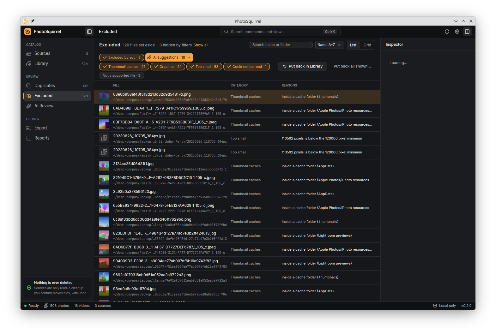

# PhotoSquirrel

PhotoSquirrel is a desktop app for macOS, Windows and Linux that sorts out years of scattered photo backups. Point
it at your drives, USB sticks, old laptops and NAS shares; it finds every photo and video, works out which files
are the same picture (exact copies, thumbnails, resized and recompressed versions), picks the best copy of each,
and copies those best copies into one clean library folder ready for Apple Photos, Google Photos or Lightroom.


## Your photos are safe

- **Your sources are read-only.** PhotoSquirrel opens the files on your drives, backups and shares only to read
  them. It never edits, renames, moves or deletes them.
- **Export only copies.** Each best copy is copied into the library folder you choose, checked against its
  original by hash, and only then given its final name. Nothing in the library is ever overwritten; running the
  export again copies only what is new.
- **A photo is never copied twice.** When a group already in your library gets another best copy later (you pick
  another keeper, a better copy turns up on a new drive, or a HEIC original can be decoded at last), the export
  copies nothing for it and lists it as a "better copy available". Only if you ask (`export run --upgrade`, or
  "Also copy the better copies" in the Export view, for that export only) is the better copy copied beside the
  library copy, in the same folder under its own name; the library copy is never removed, replaced or renamed.
  Until then Reports lists that better copy as "better copy not in the library yet": it does not count as
  accounted for, and cleanup never moves it.
- **Nothing of yours is deleted.** PhotoSquirrel never deletes or moves your source files or the finished copies
  in your library. The only files it ever removes are ones it made itself: unfinished `.partial` export copies,
  preview-cache entries and its own temporary and control files.
- **No telemetry.** The app sends nothing anywhere: no analytics, crash reports or update checks. The only
  network traffic is the optional AI feature below, and only after you start it.

## What it does

- **Scans large collections quickly and remembers them.** Hundreds of thousands of files across SSDs, hard
  drives and network shares. A rescan only looks at what changed; an interrupted scan resumes where it stopped;
  pause and cancel take effect at once. Scanning can pause by itself while a laptop runs on battery.
- **Finds the same image at any size.** Exact duplicates by content hash, plus thumbnails, resized and recompressed
  versions by perceptual hash. Burst shots and near-identical frames are only *suggested*, never
  merged for you.
- **Picks the best copy and says why.** Resolution, original file over re-encode, quality, metadata and capture
  date decide the keeper; every group explains its choice, and you can pick another keeper, split a group or
  merge two.
- **Keeps photos apart from clutter.** Icons, web and app graphics, tiny images and thumbnail caches are
  recognised and kept out of the way (you can review them under Excluded), so the library is your actual photos.
- **Reads the formats archives hold.** JPEG, PNG, WebP, GIF, BMP, camera RAW (through its embedded preview),
  HEIC/AVIF (see below) and TIFF scans of any size: 8/16-bit and floating-point, greyscale, RGB and CMYK, tiled,
  planar, multipage (the first page is the photo), JPEG-compressed and pyramid TIFFs, whatever program wrote them.
  A 1 GB scan is read once, in bounded memory, and still matched to its JPEG copies by look.
- **Shows the details.** A fast, virtualised gallery with filters, a loupe and an inspector with EXIF (camera,
  lens, exposure, date, place).
- **Copies a clean library.** Folders by date, presets for Apple Photos, Google Photos and Lightroom, optional XMP
  sidecars. A completion report accounts for every file found: exported, covered by a better copy, excluded,
  pending, unreadable or missing.
- **Optional AI descriptions, local first.** See [AI insights](#ai-insights-optional).
- **Optional, reversible cleanup.** Move the files of a drive that are already safe in your library into a
  quarantine folder on that drive, and undo it whenever you like. See [Freeing up space](#freeing-up-space-optional).

| | |
|---|---|
|  |  |
| Sources and the scan dashboard: live progress, pause, resume and cancel. | Duplicate review: each group, its keeper and why. |
|  |  |
| Export: the plan, the target app preset and the space it needs. | Reports: what happened to every file found. |

## Install

Download the file for your system from the [latest release](https://github.com/szehnder/photosquirrel2/releases).
You don't need Rust or any developer tools.

| System | Download | How |
|---|---|---|
| macOS 11+ (Apple silicon and Intel) | `PhotoSquirrel-<version>-macos-universal.dmg` | Open it and drag PhotoSquirrel to Applications |
| Windows 10/11 (x64) | `PhotoSquirrel-<version>-windows-x86_64-setup.exe` | Run it; installs for your user, no admin rights needed |
| Linux, any distribution (x64) | `PhotoSquirrel-<version>-linux-x86_64.AppImage` | `chmod +x` the file, then run it |
| Debian, Ubuntu (x64) | `PhotoSquirrel-<version>-linux-x86_64.deb` | `sudo apt install ./PhotoSquirrel-<version>-linux-x86_64.deb`; it installs as the package `photo-squirrel` (`sudo apt remove photo-squirrel`) |
| Anything else | `.tar.gz` (Linux, macOS) or `.zip` (Windows) | Unpack; both programs are inside, ready to run |

Every package contains the desktop app (`photosquirrel`), the command-line tool (`photosquirrel-cli`) and the
license notices of the open-source components they include (`THIRD-PARTY-LICENSES`). Each download has a
`.sha256` file beside it: check it with `sha256sum -c <file>.sha256` (on macOS, `shasum -a 256 -c <file>.sha256`).

### First launch

The packages are not code-signed yet, so your system warns you the first time:

- **macOS** says the app "can't be opened" or "is damaged". Right-click PhotoSquirrel in Applications and choose
  **Open**. If that doesn't work, open **System Settings → Privacy & Security** and click **Open Anyway**, or run
  `xattr -dr com.apple.quarantine /Applications/PhotoSquirrel.app` in Terminal.
- **Windows** SmartScreen says it "protected your PC". Click **More info → Run anyway**.

### Requirements

- **Linux:** glibc 2.35 or newer (Ubuntu 22.04+, Debian 12+, Fedora 36+), a Vulkan driver (Mesa is fine), the
  D-Bus, xcb and xkbcommon libraries every desktop has (the AppImage uses the system's), and optionally a Secret
  Service keyring (GNOME Keyring, KWallet) to store AI provider keys.
- **x86_64 CPUs:** about 2009 or newer (x86-64-v2: SSE4.2 and POPCNT).
- **Optional:** `ffmpeg` on your PATH for video poster frames (without it videos show a placeholder with their
  length and date).

#### HEIC and AVIF photos

PhotoSquirrel decodes HEIC/HEIF (iPhone photos) with the operating system's own decoder and ships no HEVC decoder
of its own. `photosquirrel-cli doctor` says whether this machine can decode HEIC, and if not, exactly what to
install for your system:

- **macOS:** works out of the box (ImageIO).
- **Windows 10 (1809+) and 11:** the free [HEIF Image Extensions](https://apps.microsoft.com/detail/9pmmsr1cgpwg)
  and the [HEVC Video Extensions](https://apps.microsoft.com/detail/9nmzlz57r3t7) (or the free
  [Device Manufacturer edition](https://apps.microsoft.com/detail/9n4wgh0z6vhq) when your PC maker provides it).
- **Linux:** libheif 1.12+ with its HEVC decoder, for example `sudo apt install libheif1 libheif-plugin-libde265`
  (Ubuntu 24.04+, Debian 13+), `sudo apt install libheif1` (Ubuntu 22.04, Debian 12),
  `sudo pacman -S --needed libheif libde265` (Arch), RPM Fusion's `libheif-freeworld` (Fedora) or Packman's
  `libheif1` and `libheif-ffmpeg` (openSUSE). It is loaded at run time; PhotoSquirrel starts and works without it.
- **AVIF** decodes everywhere with the bundled AV1 decoder.

Without a decoder, HEIC photos are still found, catalogued, de-duplicated as exact copies and exported; they show
"No HEIC decoder on this system", and the scan summary and the inspector say how to enable previews. After the
install, restart PhotoSquirrel and click **Fill in previews** (or rescan): only those photos are read again, and
they get previews and are matched to their resized JPEG copies. `PHOTOSQUIRREL_HEIF_DECODER=none` makes
PhotoSquirrel behave as if no decoder were found.

### Known limitations

- **TIFF limits.** Palette (indexed) and CIE L\*a\*b\* TIFFs above 64 MB are catalogued and de-duplicated by
  content only, and BigTIFF files (the variant for files above 4 GB) are catalogued with a "not supported yet"
  placeholder but not decoded. A TIFF whose image
  decodes to more than 4 GB (about 30000x24000 at 16-bit RGB) and has no smaller resolution level stored gets a
  placeholder thumbnail and is de-duplicated by content only. Colour profiles are not applied, and floating-point
  values above 1.0 are clipped.
- **Adobe RGB photos** (Canon `_MG_` files and others recorded in Adobe RGB) are shown without colour
  conversion, so their previews look slightly muted; the files themselves are exported unchanged.
- **FAT and exFAT drives** (most SD cards and many USB sticks): after the card is unplugged and inserted again,
  the next rescan may read many files again in full, because these drives do not keep stable file ids. Nothing is
  lost or grouped wrongly; it only takes about as long as the first scan.
- **Cleanup is new in 0.2.0** and optional. Without it PhotoSquirrel never touches your sources at all; with it,
  files are only moved within the same drive, after a confirmation, and every move can be undone.
- **Windows performance** has only been measured on CI machines, where writing very large catalogs (around a
  million files) was much slower than on Linux and macOS. Reports from real Windows machines are welcome.

## Quick start

1. Open PhotoSquirrel and add your sources: folders, drives, backups, network shares.
2. Scan. You can browse the library while it runs, and pause or cancel at any time.
3. Look through **Duplicates**: accept the keepers or pick your own.
4. Open **Export**, choose an empty library folder and the app you will import into, review the plan and copy.
5. Check **Reports**, then import the library folder into Apple Photos, Google Photos or Lightroom.

To try it without your own photos, `photosquirrel-cli demo` makes a small synthetic library and scans it.

## Command line

`photosquirrel-cli` does everything the app does, without a window, and works on the same catalog. Add `--json`
to any command for machine-readable output.

```sh
photosquirrel-cli sources add /Volumes/Backup         # add a source (read-only)
photosquirrel-cli scan                                # scan; Ctrl-C cancels, `scan --resume` continues
photosquirrel-cli groups list                         # duplicate groups and the space they take
photosquirrel-cli groups show 42                      # members of a group and why the keeper won
photosquirrel-cli export dry-run --library ~/Pictures/Library     # what would be copied where; writes nothing
photosquirrel-cli export run --library ~/Pictures/Library --yes   # copy, verify, rename
photosquirrel-cli export run --library ~/Pictures/Library --upgrade --yes  # also copy better copies beside
                                                      # the library copies (listed by every plan)
photosquirrel-cli report                              # what happened to every file found
photosquirrel-cli report excluded                     # excluded files by category (see the Excluded view)
photosquirrel-cli previews status                     # photos without a preview, by format and reason
photosquirrel-cli previews fill                       # fill in the previews that can be made now
photosquirrel-cli cleanup plan --source 1             # what a cleanup would move into quarantine; moves nothing
photosquirrel-cli cleanup select 3 --except-folder "Backup 2012"  # narrow the plan; moves nothing
photosquirrel-cli cleanup run 3 --yes                 # re-verify each file, then move it; never deletes
photosquirrel-cli cleanup undo 3 --folder DCIM --yes  # put one folder of a run back (or the whole run)
photosquirrel-cli cleanup discard 4                   # drop a plan you will not run; touches no file
photosquirrel-cli doctor                              # version, data folder, optional decoders, AI provider
```

`photosquirrel-cli --help` and `photosquirrel-cli <command> --help` list every option.

Log messages go to standard error. By default they are PhotoSquirrel's own warnings and errors, and only the errors
of the EXIF and RAW decoders it uses (their warnings are per-file notes to their own developers; what a file's
problem means for you is in the scan summary and `previews status`). `RUST_LOG` replaces this default:
`RUST_LOG=warn,nom_exif=error,rawler=warn photosquirrel-cli scan` adds the RAW decoder's diagnostics, such as "No
lens definition found in database", for a bug report (`RUST_LOG=rawler=warn` alone shows only the RAW decoder's), and `RUST_LOG=debug` shows everything. The app reads `RUST_LOG` the same way.

With "pause scans on battery" on (Settings, General, or `pause_on_battery = true` under `[general]` in
`settings.toml`), a scan started from the command line pauses too when the computer switches to battery power,
and, unlike the app, which asks, **resumes by itself** once mains power is back, so an unattended overnight scan
finishes. A pause you asked for with `scan pause` is never resumed for you, and `scan resume` on battery keeps the
scan going until the next unplug. Each pause and resume is one line on standard error; with `--json` it is also an
NDJSON line `{"type": "power", "data": {"event": "paused_on_battery" | "resumed_on_mains", "run": ..., "at_ms":
...}}`, and while a scan is paused its snapshot lines slow to one every 5 seconds. `scan status` shows a scan
paused on battery. `--ignore-battery` on `scan`, `scan start` or `scan resume` skips the pause for the scan that
command runs; it has no effect (and says so) when `scan resume` only resumes a scan already running in another
terminal. `PHOTOSQUIRREL_POWER_SUPPLY_DIR` points the power check at a folder laid out like Linux's
`/sys/class/power_supply` instead of the system's own (on any platform; for testing and support; a warning says
it is in use, and `doctor` shows it).

## The Excluded view

Everything PhotoSquirrel keeps out of the library is listed under **Excluded**, each file once, under the first of
these categories that fits: excluded by you, an AI suggestion you accepted (screenshots, documents, graphics, not a
photo), thumbnail caches, graphics, too small (icons, tiny images, very short videos), could not be read (a photo or
video whose file could not be read here: a damaged TIFF, an `IMG_9999.JPG` whose first bytes are broken, a file the
disk would not give back) and **Not a supported file** (anything that is not a photo or video at all). Every file
still lists all of its reasons.

- **Filter by category.** Each chip shows its count and turns its files on or off; the AI chip has one entry per kind
  of suggestion. "Not a supported file" is off at first, and the view says how many files the filters hide (**Show
  all** turns every chip on). A search box matches the path the list shows (the source folder, the folders under it
  and the name, in any case and script), and the list sorts by name, folder, size or category. Your choices are
  remembered for each catalog. The chips are keyboard stops: Tab moves between them, Space or Enter turns one on or
  off.
- **List or Grid.** The list shows a thumbnail, the file and its folder, its category and its reasons; the grid is
  the Library's grid limited to the files shown, with each file's category on its tile. Selecting a file shows it in
  the inspector. In the list, the arrow keys (or J and K) move, Shift extends the selection, Ctrl+A (⌘A) selects
  every file shown, P puts the selection back, Shift+P asks to put back everything shown, Enter confirms and Escape
  cancels.
- **Put back in Library.** Put back the selected files, or every file the filters show (after a confirmation with
  the count). They are included by you from then on, rescans keep that, and excluding them again undoes it. Putting
  back a file an AI suggestion excluded also rejects that suggestion, so the next AI run does not suggest it again.
  No file is touched: this only records your decision.



```sh
photosquirrel-cli report excluded                       # files per category and AI kind
photosquirrel-cli report excluded --category ai:document --category unsupported   # and those files with reasons
```

## Capture dates

Each photo is filed by the best date known for it, in this order: the camera's DateTimeOriginal, CreateDate, the
video's creation date, a date in the name of a folder holding it, and only then the file's modification time.
For the library, a copy without a date of its own borrows the date another copy of the same photo has (its EXIF,
a date in its file name or XMP sidecar, then its folder).

- **Folder dates.** Folders inside a source whose names start with a date count: `2019-07-04`, `2019_07_04 Beach`,
  `2019.07.04`, `20190704`, a dated tree such as `2019/07/04`, and month folders such as `2019-07 Italy` or
  `2019/07`. A year alone (`2019`), a date later in the name (`Backup 2019-07-04`) and the source folder's own name
  are never used, and a folder date more than a day after the file was last modified is ignored (it names a
  backup or an import, not the photo), except when the modification time is before 1990 (an unset camera
  clock, which says nothing). Folders named for two years, such as `2011-12 School Year` or `2011-2012`, are not
  month dates; a bare `2010-11`, or `2010-11 Trip` inside a `2010` folder, is still November 2010. Folder dates never decide duplicates or keepers.
- **Honest precision.** A month folder dates its photos to the month only: the inspector shows "July 2019", from
  the folder name, and the library files them under `<YYYY>/<YYYY-MM>/` instead of inventing a day.
- **Local days.** A file's modification time, and a video creation time recorded only in UTC, count on the day
  it was where you are: the offset the file records, else your computer's time zone at that moment (daylight
  saving included). Camera dates, and phone video dates that record their zone, keep their own clock and are
  never shifted. Files with only a modification time go
  under `Undated/<YYYY>/<YYYY-MM-DD>/`.
- **Existing catalogs and libraries.** After an update that changes these rules, the next rescan re-dates the
  catalog from what it already knows, without reading any file, and says how many dates changed. Copies already
  in your library stay where they are and are never copied again; only photos not yet exported use the new
  folders, and the export plan says how many copies are filed under earlier rules. A library written by another
  catalog (for example after starting over with a new data folder) gets a warning in the plan: files already in
  it may be copied again into different folders, and nothing in it is ever overwritten.
- **Older catalogs.** Files analysed by a version before classification facts were stored keep their class; the
  scan summary counts them and offers **Refresh analysis** (`photosquirrel-cli scan --refresh-analysis`), which
  re-reads only the first 256 KB of each such file, read-only, to classify it again.

```sh
photosquirrel-cli scan                                         # re-dates old rows, reads nothing for them
photosquirrel-cli scan --refresh-analysis                      # also re-classifies files from older versions
photosquirrel-cli --json export dry-run --library ~/Pictures/Library   # each file's date, precision and source
```

## Photos without a preview

Some files cannot be drawn on this computer, or by this version: a HEIC without the system's decoder, a TIFF
variant this version does not read (BigTIFF), a video without a poster-frame tool, a damaged file. They are never
blank squares. Each one gets a placeholder tile with its format ("TIFF", "HEIC"), "No preview" and a mark that
says what kind of problem it is:

- **needs a library** (download mark): install the decoder this system lacks;
- **ready to fill in** (refresh mark): a preview can be made now;
- **not supported yet** (info mark): a later version may read it;
- **damaged** (warning mark): the decoder could not read the data.

Such files are still catalogued, matched by exact content and exported. Hover a tile and click its info button
(or select it and press Shift+I), or use **Why no preview?** in the inspector or the loupe: the dialog names
the reason in plain words and what to do, from install steps for your system to **Fill in previews**, and "Show
them" lists every file with the same reason (the Library's **Preview** menu does the same).

**Fill in previews** re-decodes only the files whose placeholder can become a preview now, after you installed a
decoder or updated PhotoSquirrel (0.3.0 reads TIFFs that 0.2.0 could not). It reads each such file once, walks no
folder, skips files on drives that are not connected (and counts them), regroups the files it filled in, and can
be paused and cancelled like a scan. The Library offers it in a one-line notice when files are waiting; the next
rescan of a source fills them in too. On the command line:

```
photosquirrel-cli previews status            # placeholders by format and reason, and how many can be filled in
photosquirrel-cli previews fill --format heic # fill in previews (Ctrl-C stops; the rest keeps waiting)
```

## Freeing up space (optional)

In Reports, **Free up space** appears on every drive that has files whose best copy is already in your library
(exported, or a duplicate of an exported photo); the drive does not have to be fully accounted for. It plans a
cleanup of exactly those files, shown as a tree of folders with the space you can free. Pending, excluded,
unreadable and missing files are never included, nor a better copy of a photo whose library holds only a lesser
copy (copy it with `export run --upgrade` first). Nothing moves until you confirm the plan. A move stays on the
same drive, so the space is only freed once you delete the quarantine folder yourself (see below).

- **Narrow the plan before you confirm it.** Every folder has a check box; expand a folder to tick or untick single
  files. Unticked files stay where they are: the run never checks, journals or moves them. **Move N files…**
  saves your selection with the plan and the confirmation shows exactly what will move; until the run moves a
  file you can tick it again. On the command line, `cleanup select <run>` does the same with repeatable
  `--folder`, `--file` (ids from `cleanup show`), `--except-folder` and `--except-file`, or `--all` for the whole
  plan again; `cleanup show` lists left-out files as `unselected`. Each `cleanup select` **replaces** the previous
  selection rather than adding to it, so name everything you want in one command. Folder names match exactly
  and case-sensitively; a `--folder`, `--file`, `--except-folder` or `--except-file` that matches nothing is
  reported as a warning (on standard error and as `unmatched` in `--json`), with the folder that differs only
  in case if there is one, and `cleanup undo` warns the same way.
- **Discard a plan** you will not run with **Discard plan** (or **Discard** in the history), or
  `photosquirrel-cli cleanup discard <run>`. Nothing on the drive changes and the plan stays in the history as
  discarded. A run that has moved any file cannot be discarded, even after an undo.

- Right before each move, the file is read and hashed again and its library copy re-verified. Anything that
  changed, or whose library copy is gone, stays where it is and is listed with the reason.
- Files are **renamed** into `.photosquirrel-quarantine/<run>/` at the top of the same drive, keeping their folder
  structure, by a rename that fails rather than replace anything. Where a drive cannot rename that way (some
  network shares and FUSE or exFAT drives), the file gets its new name as a hard link first and loses its old
  name only once both are the same file; a drive that can do neither (FAT, some shares) is left alone and the
  plan lists why. Nothing is copied, nothing is overwritten, nothing is deleted, and a move to another drive is
  refused.
- Every move is written to a journal first (in the catalog and as `journal.jsonl` in the run's quarantine folder),
  so an interrupted cleanup is sorted out on the next start.
- **Undo…** shows the run's quarantined folders in the same tree: put everything back, or only the folders and
  files you tick (the command line takes `--folder`, `--file`, `--except-folder` and `--except-file`). A file
  whose old place is now taken by something else stays in quarantine and is reported; it never overwrites. After
  a full undo the empty folders the run created are removed; the journal stays.
- While a drive has files in quarantine it cannot be removed from PhotoSquirrel (or folded into a folder that
  contains it): undo its runs first.
- PhotoSquirrel never empties or deletes a quarantine folder; that is up to you. Before you delete one with your
  file manager, check its drive with **Verify copies** in Reports (or `photosquirrel-cli report --verify`): only
  when the drive is 100% accounted for is every file in its quarantine also in your library. If a library copy
  has gone missing or changed, Reports lists the quarantined files that are no longer covered as pending ("only in
  the quarantine folder"), even ones you have excluded since, and the next export copies them from the quarantine
  folder again (an excluded one once you include it again).


## AI insights (optional)

PhotoSquirrel can ask a vision model to describe your keepers (subject, category, whether there are people,
children or pets) so you can filter and review by them. It is off until you start it, and it is advisory only:
AI answers never decide grouping, keepers, export or exclusion.

- The default provider is **[LM Studio](https://lmstudio.ai) on your own computer**: load a vision model there and
  start its server; your photos never leave the machine.
- Ollama and other OpenAI-compatible servers work too, as do OpenAI, Anthropic and Google Gemini. A hosted
  provider needs an explicit consent that names the provider, because it means uploading previews of your photos.
- Only a 1024 px preview is sent, never the original file. API keys are kept in your system keychain.


## Building from source

You need Rust (the version in `rust-toolchain.toml` is installed automatically by rustup), on x86_64 `nasm` (for
the AVIF decoder's assembly; without it, build with `--no-default-features` for slower AVIF decoding), and, on
Linux, the GPUI system libraries:

```sh
# Debian/Ubuntu
sudo apt install libxkbcommon-dev libxkbcommon-x11-dev libwayland-dev libvulkan-dev libfontconfig-dev \
  libfreetype-dev libx11-xcb-dev libxcb1-dev libssl-dev libsecret-1-dev libdbus-1-dev pkg-config nasm

# Arch/Manjaro (use pacman -S instead of yay -S if you prefer; also install a Vulkan driver for your GPU:
# vulkan-intel, vulkan-radeon or nvidia-utils)
yay -S --needed base-devel libxkbcommon libxkbcommon-x11 wayland vulkan-icd-loader vulkan-headers \
  fontconfig freetype2 libx11 libxcb openssl libsecret dbus pkgconf nasm
```

```sh
cargo xtask doctor                          # checks prerequisites (nasm); libheif, ffmpeg and LM Studio are optional
cargo run --release -p photosquirrel        # the app
cargo run --release -p photosquirrel-cli -- --help
cargo xtask package                         # installers for this OS into target/packages (needs cargo-packager, cargo-about)
```

## Contributing

Architecture decisions are in [`docs/adr/`](docs/adr/README.md) and the specs in [`openspec/`](openspec/).
[`AGENTS.md`](AGENTS.md) describes the workflow, the crate layering and the rules every change keeps (above all:
never lose a photo). `cargo xtask ci` runs everything CI checks.

## License

PhotoSquirrel is licensed under the [Apache License 2.0](LICENSE). The licenses of the components it includes are
listed in `THIRD-PARTY-LICENSES` in every package.

**LGPL components.** The raw-photo decoder [rawler](https://crates.io/crates/rawler) 0.8.0 is licensed under the
LGPL-2.1 and is linked statically into both programs. Its source is on crates.io and attached to every release
(`rawler-0.8.0.crate`); the complete source of a release is its tag, `https://github.com/szehnder/photosquirrel2/tree/v<version>`,
with the `Cargo.lock` and the pinned Rust toolchain it was built with. To relink against a modified rawler, unpack
it next to the source, add

```toml
[patch.crates-io]
rawler = { path = "../rawler-0.8.0" }
```

to the workspace `Cargo.toml` and run `cargo build --profile dist -p photosquirrel -p photosquirrel-cli`.

**AppImage runtime.** The Linux AppImage starts with the [AppImage runtime](https://github.com/AppImage/type2-runtime),
the small program that mounts the image. PhotoSquirrel ships the build pinned in
[`packaging/linux/appimage-runtime.toml`](packaging/linux/appimage-runtime.toml); it contains musl, squashfuse, zstd,
zlib and libfuse 3.15.0, which is LGPL-2.1 and linked statically. Every release attaches the libfuse source the
runtime was built from (`fuse-3.15.0.tar.xz`) and the patch the runtime applies to it, and, to relink the runtime
against a modified libfuse, the source of the runtime itself (`type2-runtime-dd6cebe.tar`) and of squashfuse
(`squashfuse-0.5.2.tar.gz`). The AppImage's `THIRD-PARTY-LICENSES` lists each component with its license.
