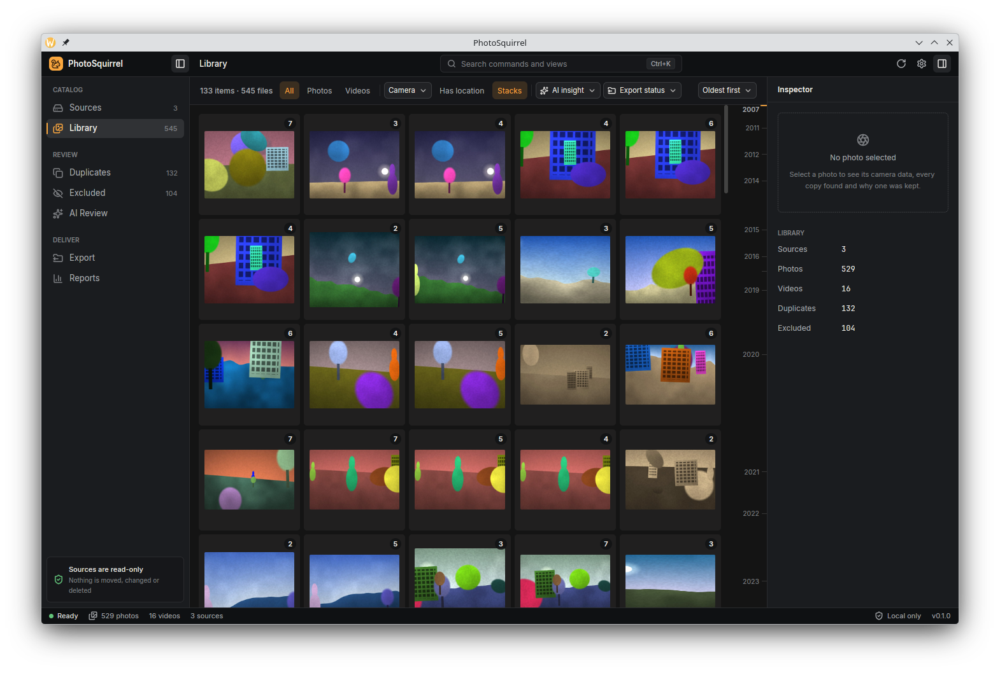
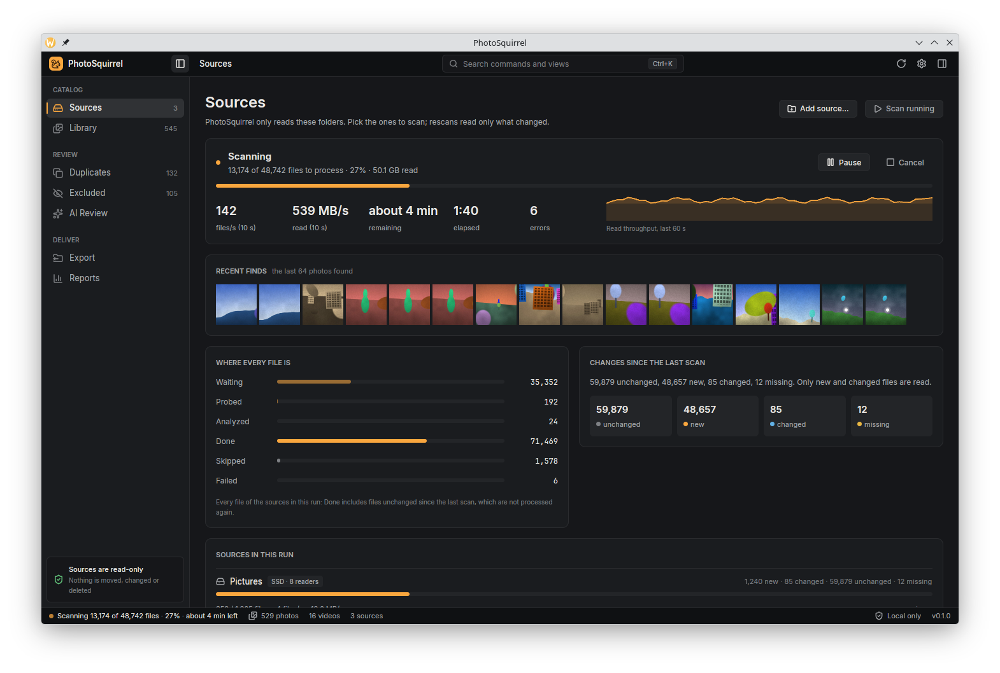
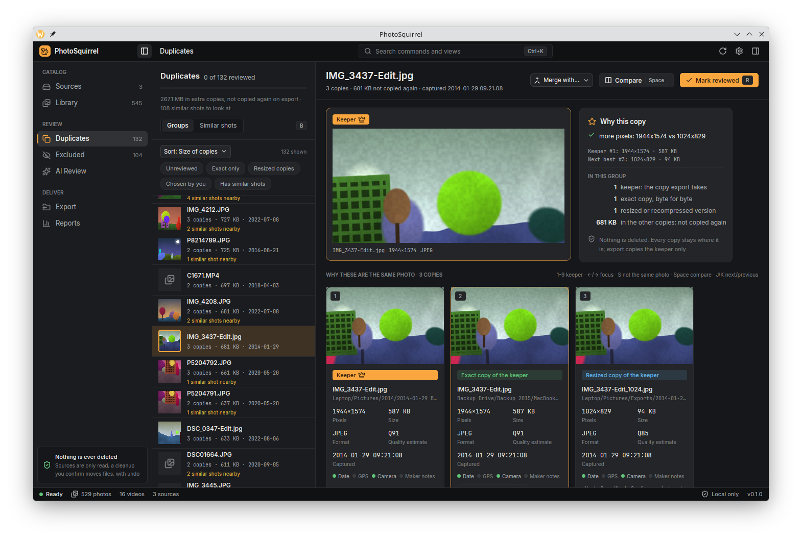
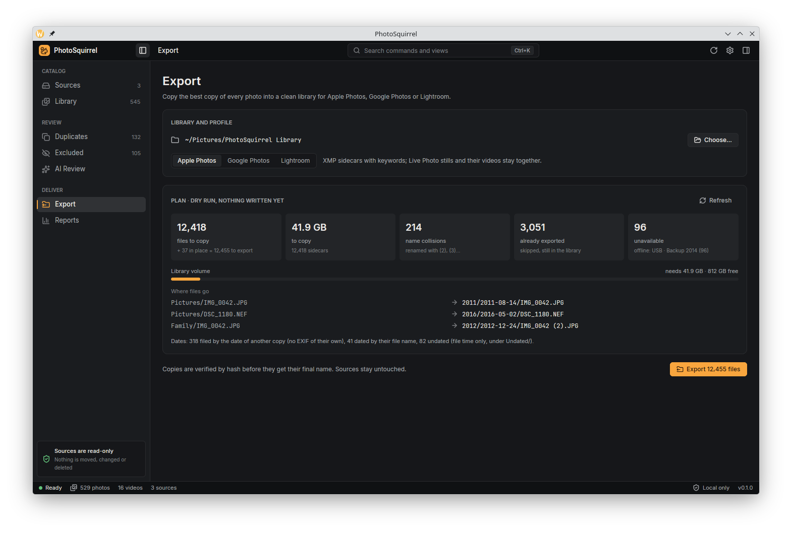
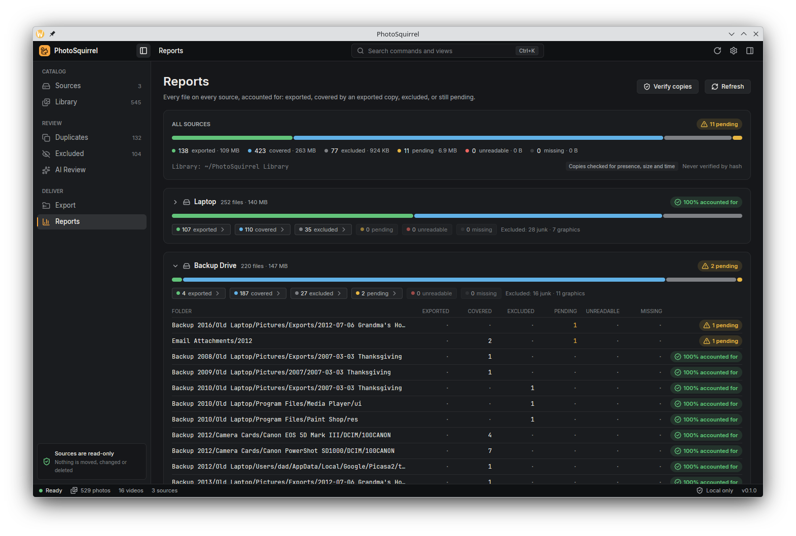
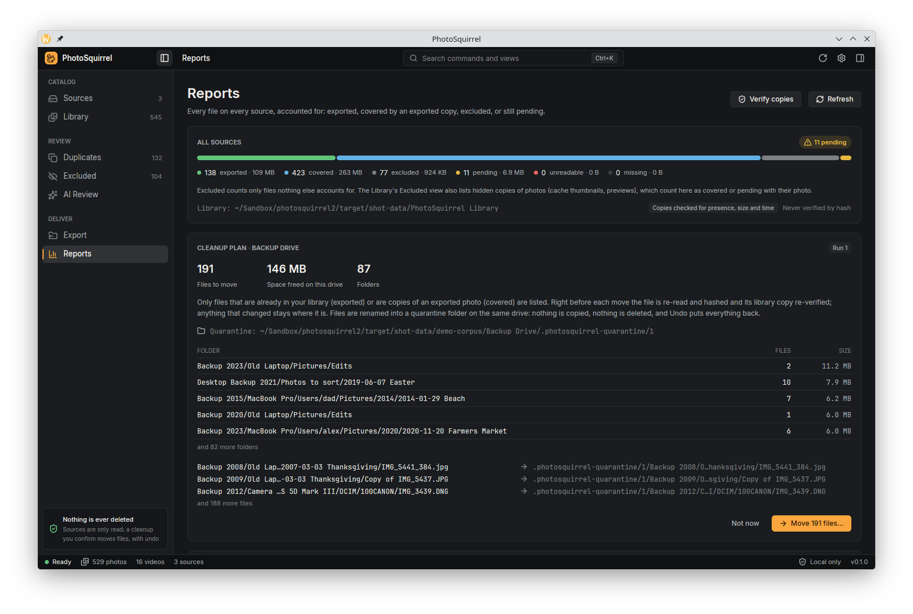
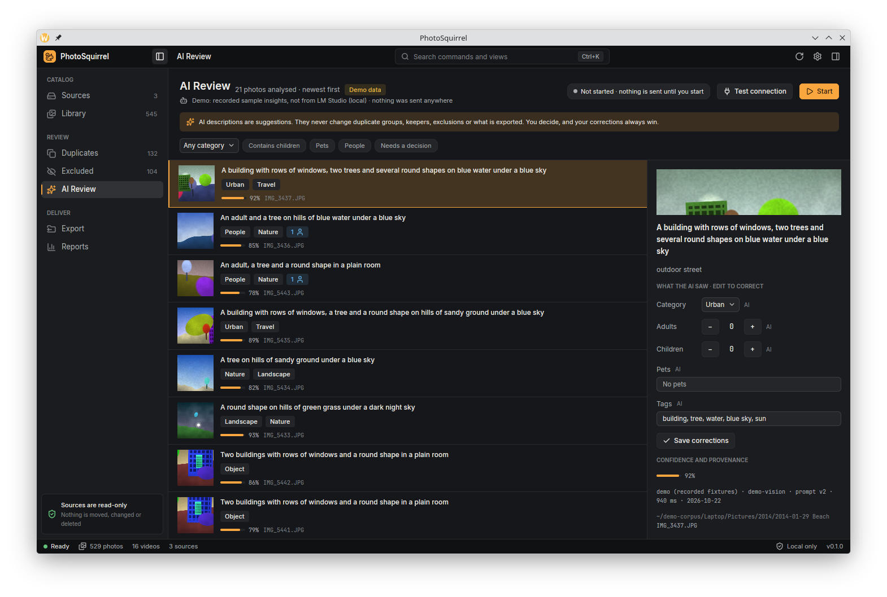

# PhotoSquirrel

PhotoSquirrel is a desktop app for macOS, Windows and Linux that sorts out years of scattered photo backups. Point
it at your drives, USB sticks, old laptops and NAS shares; it finds every photo and video, works out which files
are the same picture (exact copies, thumbnails, resized and recompressed versions), picks the best copy of each,
and copies those best copies into one clean library folder ready for Apple Photos, Google Photos or Lightroom.



## Your photos are safe

- **Your sources are read-only.** PhotoSquirrel opens the files on your drives, backups and shares only to read
  them. It never edits, renames, moves or deletes them.
- **Export only copies.** Each best copy is copied into the library folder you choose, checked against its
  original by hash, and only then given its final name. Nothing in the library is ever overwritten; running the
  export again copies only what is new.
- **Nothing of yours is deleted.** PhotoSquirrel never deletes or moves your source files or the finished copies
  in your library. The only files it ever removes are ones it made itself: unfinished `.partial` export copies,
  preview-cache entries and its own temporary and control files.
- **No telemetry.** The app sends nothing anywhere: no analytics, crash reports or update checks. The only
  network traffic is the optional AI feature below, and only after you start it.

## What it does

- **Scans large collections quickly and remembers them.** Hundreds of thousands of files across SSDs, hard
  drives and network shares. A rescan only looks at what changed; an interrupted scan resumes where it stopped;
  pause and cancel take effect at once. Scanning can pause by itself while a laptop runs on battery.
- **Finds the same image at any size.** Exact duplicates by content hash, plus thumbnails, resized and recompressed
  versions by perceptual hash. Burst shots and near-identical frames are only *suggested*, never
  merged for you.
- **Picks the best copy and says why.** Resolution, original file over re-encode, quality, metadata and capture
  date decide the keeper; every group explains its choice, and you can pick another keeper, split a group or
  merge two.
- **Keeps photos apart from clutter.** Icons, web and app graphics, tiny images and thumbnail caches are
  recognised and kept out of the way (you can review them under Excluded), so the library is your actual photos.
- **Shows the details.** A fast, virtualised gallery with filters, a loupe and an inspector with EXIF (camera,
  lens, exposure, date, place).
- **Copies a clean library.** Folders by date, presets for Apple Photos, Google Photos and Lightroom, optional XMP
  sidecars. A completion report accounts for every file found: exported, covered by a better copy, excluded,
  pending, unreadable or missing.
- **Optional AI descriptions, local first.** See [AI insights](#ai-insights-optional).
- **Optional, reversible cleanup.** Move the files of a drive that are already safe in your library into a
  quarantine folder on that drive, and undo it whenever you like. See [Freeing up space](#freeing-up-space-optional).

| | |
|---|---|
|  |  |
| Sources and the scan dashboard: live progress, pause, resume and cancel. | Duplicate review: each group, its keeper and why. |
|  |  |
| Export: the plan, the target app preset and the space it needs. | Reports: what happened to every file found. |

## Install

Download the file for your system from the [latest release](https://github.com/szehnder/photosquirrel2/releases).
You don't need Rust or any developer tools.

| System | Download | How |
|---|---|---|
| macOS 11+ (Apple silicon and Intel) | `PhotoSquirrel-<version>-macos-universal.dmg` | Open it and drag PhotoSquirrel to Applications |
| Windows 10/11 (x64) | `PhotoSquirrel-<version>-windows-x86_64-setup.exe` | Run it; installs for your user, no admin rights needed |
| Linux, any distribution (x64) | `PhotoSquirrel-<version>-linux-x86_64.AppImage` | `chmod +x` the file, then run it |
| Debian, Ubuntu (x64) | `PhotoSquirrel-<version>-linux-x86_64.deb` | `sudo apt install ./PhotoSquirrel-<version>-linux-x86_64.deb`; it installs as the package `photo-squirrel` (`sudo apt remove photo-squirrel`) |
| Anything else | `.tar.gz` (Linux, macOS) or `.zip` (Windows) | Unpack; both programs are inside, ready to run |

Every package contains the desktop app (`photosquirrel`), the command-line tool (`photosquirrel-cli`) and the
licence notices of the open-source components they include (`THIRD-PARTY-LICENSES`). Each download has a
`.sha256` file beside it: check it with `sha256sum -c <file>.sha256` (on macOS, `shasum -a 256 -c <file>.sha256`).

### First launch

The packages are not code-signed yet, so your system warns you the first time:

- **macOS** says the app "can't be opened" or "is damaged". Right-click PhotoSquirrel in Applications and choose
  **Open**. If that doesn't work, open **System Settings → Privacy & Security** and click **Open Anyway**, or run
  `xattr -dr com.apple.quarantine /Applications/PhotoSquirrel.app` in Terminal.
- **Windows** SmartScreen says it "protected your PC". Click **More info → Run anyway**.

### Requirements

- **Linux:** glibc 2.35 or newer (Ubuntu 22.04+, Debian 12+, Fedora 36+), a Vulkan driver (Mesa is fine), the
  D-Bus, xcb and xkbcommon libraries every desktop has (the AppImage uses the system's), and optionally a Secret
  Service keyring (GNOME Keyring, KWallet) to store AI provider keys.
- **x86_64 CPUs:** about 2009 or newer (x86-64-v2: SSE4.2 and POPCNT).
- **Optional:** `ffmpeg` on your PATH for video poster frames (without it videos show a placeholder with their
  length and date).

### Known limitations

- **HEIC previews.** The prebuilt packages do not decode HEIC/HEIF yet. iPhone HEIC photos are still found,
  catalogued, de-duplicated by content and exported; they show "preview unavailable" and are not matched to
  resized copies by look. Building from source with libheif 1.17+ and `--features heic` turns decoding on. The
  release notes say which platforms this applies to.
- **Cleanup is new since 0.1.0** (built from source; not in the 0.1.0 packages). Without it PhotoSquirrel never
  touches your sources at all.
- **Windows performance** has only been measured on CI machines, where writing very large catalogs (around a
  million files) was much slower than on Linux and macOS. Reports from real Windows machines are welcome.

## Quick start

1. Open PhotoSquirrel and add your sources: folders, drives, backups, network shares.
2. Scan. You can browse the library while it runs, and pause or cancel at any time.
3. Look through **Duplicates**: accept the keepers or pick your own.
4. Open **Export**, choose an empty library folder and the app you will import into, review the plan and copy.
5. Check **Reports**, then import the library folder into Apple Photos, Google Photos or Lightroom.

To try it without your own photos, `photosquirrel-cli demo` makes a small synthetic library and scans it.

## Command line

`photosquirrel-cli` does everything the app does, without a window, and works on the same catalog. Add `--json`
to any command for machine-readable output.

```sh
photosquirrel-cli sources add /Volumes/Backup         # add a source (read-only)
photosquirrel-cli scan                                # scan; Ctrl-C cancels, `scan --resume` continues
photosquirrel-cli groups list                         # duplicate groups and the space they take
photosquirrel-cli groups show 42                      # members of a group and why the keeper won
photosquirrel-cli export dry-run --library ~/Pictures/Library     # what would be copied where; writes nothing
photosquirrel-cli export run --library ~/Pictures/Library --yes   # copy, verify, rename
photosquirrel-cli report                              # what happened to every file found
photosquirrel-cli cleanup plan --source 1             # what a cleanup would move into quarantine; moves nothing
photosquirrel-cli cleanup run 3 --yes                 # re-verify each file, then move it; never deletes
photosquirrel-cli cleanup undo 3 --yes                # put a run's files back
photosquirrel-cli doctor                              # version, data folder, optional decoders, AI provider
```

`photosquirrel-cli --help` and `photosquirrel-cli <command> --help` list every option.

## Freeing up space (optional)

In Reports, **Free up space** appears on every drive that has files whose best copy is already in your library
(exported, or a duplicate of an exported photo); the drive does not have to be fully accounted for. It plans a
cleanup of exactly those files, listed with where each would go, per folder, with the space it frees. Pending,
excluded, unreadable and missing files are never included. Nothing moves until you confirm the plan.

- Right before each move, the file is read and hashed again and its library copy re-verified. Anything that
  changed, or whose library copy is gone, stays where it is and is listed with the reason.
- Files are **renamed** into `.photosquirrel-quarantine/<run>/` at the top of the same drive, keeping their folder
  structure, by a rename that fails rather than replace anything. Where a drive cannot rename that way (some
  network shares and FUSE or exFAT drives), the file gets its new name as a hard link first and loses its old
  name only once both are the same file; a drive that can do neither (FAT, some shares) is left alone and the
  plan lists why. Nothing is copied, nothing is overwritten, nothing is deleted, and a move to another drive is
  refused.
- Every move is written to a journal first (in the catalog and as `journal.jsonl` in the run's quarantine folder),
  so an interrupted cleanup is sorted out on the next start.
- **Undo** puts a whole run back (the command line can also undo one folder or some files). A file whose old place
  is now taken by something else stays in quarantine and is reported; it never overwrites. After a full undo the
  empty folders the run created are removed; the journal stays.
- While a drive has files in quarantine it cannot be removed from PhotoSquirrel (or folded into a folder that
  contains it): undo its runs first.
- PhotoSquirrel never empties or deletes a quarantine folder; that is up to you. Before you delete one with your
  file manager, check its drive with **Verify copies** in Reports (or `photosquirrel-cli report --verify`): only
  when the drive is 100% accounted for is every file in its quarantine also in your library. If a library copy
  has gone missing or changed, Reports lists the quarantined files that are no longer covered as pending ("only in
  the quarantine folder"), and the next export copies them from the quarantine folder again.



## AI insights (optional)

PhotoSquirrel can ask a vision model to describe your keepers (subject, category, whether there are people,
children or pets) so you can filter and review by them. It is off until you start it, and it is advisory only:
AI answers never decide grouping, keepers, export or exclusion.

- The default provider is **[LM Studio](https://lmstudio.ai) on your own computer**: load a vision model there and
  start its server; your photos never leave the machine.
- Ollama and other OpenAI-compatible servers work too, as do OpenAI, Anthropic and Google Gemini. A hosted
  provider needs an explicit consent that names the provider, because it means uploading previews of your photos.
- Only a 1024 px preview is sent, never the original file. API keys are kept in your system keychain.



## Building from source

You need Rust (the version in `rust-toolchain.toml` is installed automatically by rustup) and, on Linux, the
GPUI system libraries:

```sh
# Debian/Ubuntu
sudo apt install libxkbcommon-dev libxkbcommon-x11-dev libwayland-dev libvulkan-dev libfontconfig-dev \
  libfreetype-dev libx11-xcb-dev libxcb1-dev libssl-dev libsecret-1-dev libdbus-1-dev pkg-config

# Arch/Manjaro (use pacman -S instead of yay -S if you prefer; also install a Vulkan driver for your GPU:
# vulkan-intel, vulkan-radeon or nvidia-utils)
yay -S --needed base-devel libxkbcommon libxkbcommon-x11 wayland vulkan-icd-loader vulkan-headers \
  fontconfig freetype2 libx11 libxcb openssl libsecret dbus pkgconf
```

```sh
cargo xtask doctor                          # checks prerequisites; libheif, ffmpeg and LM Studio are optional
cargo run --release -p photosquirrel        # the app
cargo run --release -p photosquirrel-cli -- --help
cargo run --release -p photosquirrel --features heic   # with HEIC decoding (needs libheif 1.17+)
cargo xtask package                         # installers for this OS into target/packages (needs cargo-packager, cargo-about)
```

## Contributing

Architecture decisions are in [`docs/adr/`](docs/adr/README.md) and the specs in [`openspec/`](openspec/).
[`AGENTS.md`](AGENTS.md) describes the workflow, the crate layering and the rules every change keeps (above all:
never lose a photo). `cargo xtask ci` runs everything CI checks.

## Licence

PhotoSquirrel is licensed under the [Apache License 2.0](LICENSE). The licences of the components it includes are
listed in `THIRD-PARTY-LICENSES` in every package.

**LGPL components.** The raw-photo decoder [rawler](https://crates.io/crates/rawler) 0.8.0 is licensed under the
LGPL-2.1 and is linked statically into both programs. Its source is on crates.io and attached to every release
(`rawler-0.8.0.crate`); the complete source of a release is its tag, `https://github.com/szehnder/photosquirrel2/tree/v<version>`,
with the `Cargo.lock` and the pinned Rust toolchain it was built with. To relink against a modified rawler, unpack
it next to the source, add

```toml
[patch.crates-io]
rawler = { path = "../rawler-0.8.0" }
```

to the workspace `Cargo.toml` and run `cargo build --profile dist -p photosquirrel -p photosquirrel-cli`.
